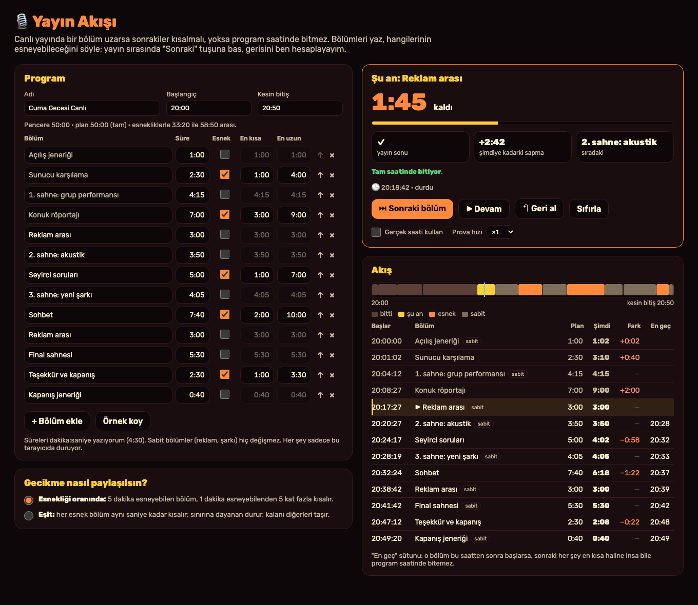
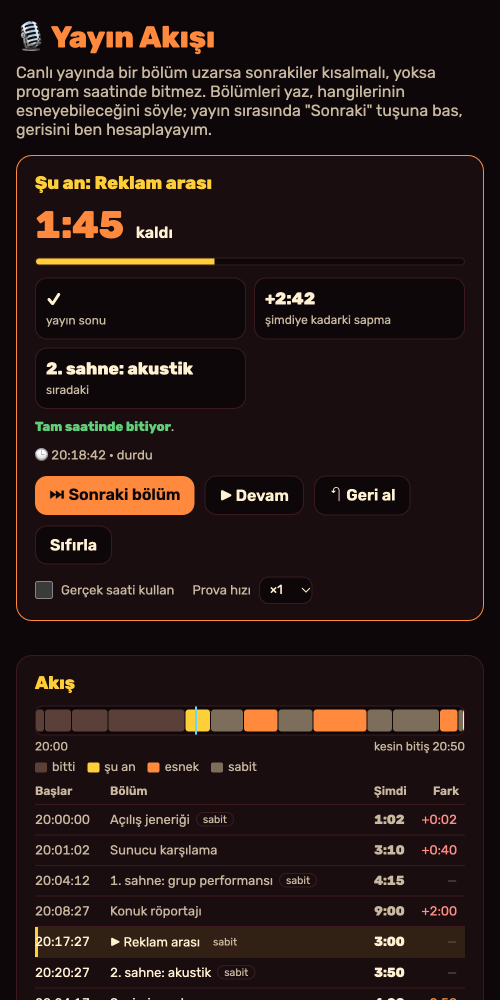

# 🎙️ Yayın Akışı

Aklıma bu geldi: canlı bir programda konuk röportajı iki dakika uzarsa ne olur? Reklam arası ve şarkılar kısalamaz, yayın da kesin saatinde bitmek zorunda. Uzayan süre bir yerden kesilmeli. Ama hangi bölümden, ne kadar? Ben bunu yayın sırasında hesaplayan bir akış planlayıcısı yaptım. Bölümleri ve hangilerinin esneyebileceğini yazıyorum; yayın sırasında her bölüm bitince "Sonraki"ye basıyorum. Sayfa kalan esnek bölümlerin yeni sürelerini, başlama saatlerini ve en geç ne zaman başlamaları gerektiğini anında gösteriyor.

## Ben nasıl kullanıyorum?

1. Klasörde `python3 -m http.server 8000` komutunu çalıştırıp tarayıcıda `http://localhost:8000` adresini açıyorum. (`?ornek` eklersem uydurma bir yayının ortası açılıyor.)
2. **Program** kartına başlangıcı, kesin bitişi ve bölümleri yazıyorum. Süreler `4:30` gibi. Esnek bölümlere en kısa ve en uzun sürelerini veriyorum; sabit bölümler hiç değişmiyor. Üstteki satır planın pencereye sığıp sığmadığını söylüyor.
3. **Gecikme nasıl paylaşılsın?** kısmında iki yoldan birini seçiyorum: esnekliği oranında ya da eşit.
4. **▶ Başlat** ile saati başlatıyorum, her bölüm bitince **⏭ Sonraki bölüm**e basıyorum. Yanlış basarsam **↶ Geri al** var.
   - Prova için saati ×10 ya da ×60 hızlandırabiliyorum.
   - Gerçek yayında **Gerçek saati kullan** kutusunu işaretliyorum.
5. **Akış** tablosunda her bölümün planlanan süresini, yeni süresini ve farkını görüyorum. "En geç" saati kırmızıya dönerse o bölüm artık kurtarılamayacak kadar geç başlıyor demek.

## Ben içeride ne yaptım?

- `core.mjs` bütün hesabı yapıyor, `app.mjs` sadece ekranı çiziyor.
- **Durum:** yayın başlangıçta başlamış sayılıyor. Her "Sonraki" basışı o bölümün bitiş saatini kaydediyor. Şu anki bölüm son kayıttan beri sürüyor; geçen süresi kendi en kısa ve en uzun sınırından düşülüyor.
- **Paylaştırma:** kalan pencere (kesin bitiş − şimdi), kalan bölümlere dağıtılıyor.
  - **Esnekliği oranında:** gereken kısalma, her bölümün kısalabileceği payla orantılı bölünüyor. Bu yolda hiçbir bölüm kendi sınırını aşamıyor, çünkü her biri payının aynı yüzdesini kullanıyor.
  - **Eşit:** "su doldurma" yöntemini kullanıyorum. Herkes aynı miktar kısalıyor; payı biten bölüm duruyor, kalanı diğerleri paylaşıyor. Payları küçükten büyüğe sıralayıp ortak seviyeyi tek geçişte buluyorum.
  - Uzatma (program erken giderse) aynı kurallarla ters yönde çalışıyor.
- **Tam saniye:** yeni süreleri en büyük kalan yöntemiyle tam saniyeye yuvarlıyorum. Toplam tam tutuyor ve sınırlar korunuyor.
- **Sığmazsa:** esnek bölümlerin hepsi en kısada bile yetmiyorsa hepsini en kısaya indiriyorum ve yayının kaç saniye geç biteceğini söylüyorum. Dolmazsa aynısını ters yönde yapıyorum.
- **En geç başlama:** sondan geriye doğru en kısa süreleri topluyorum. Kesin bitişten bu toplamı çıkarınca, o bölümün en geç ne zaman başlayabileceği çıkıyor.
- **Sabit bölüm uzarsa** (canlı bağlantı kopması gibi): ekranda süresini ne kadar aştığı gösteriliyor ve aşan süre kalan esnek bölümlerden kesiliyor.

## Ben neyi sınadım?

Ben `node test.mjs` komutunu çalıştırdım. **28 kontrol** geçti.

- **Elle hesapladığım örnekler:**
  - Payları 100 ve 300 saniye olan iki bölüm 80 saniye kısalacaksa, oranlı yolda 20 ve 60, eşit yolda 40 ve 40 kısalıyorlar.
  - Payları 10, 100 ve 100 olan üç bölüm 150 saniye kısalacaksa, eşit yolda ilki 10'da duruyor, diğerleri 70'er kısalıyor.
- **3000 rastgele durum, iki yolda da:**
  - Her süre tam sayı ve kendi sınırının içinde.
  - Toplam, hedefe sığmayan kısımla birlikte tam tutuyor.
  - Kısalma gerekirken hiçbir bölüm uzamıyor, uzatma gerekirken hiçbiri kısalmıyor.
  - Sığmadığında herkes en kısada, dolmadığında herkes en uzunda.
- **Örnek yayın:**
  - Karşılama 40 saniye, röportaj 2 dakika uzamış; açılış jeneriği de 2 saniye gecikmiş. Toplam 2 dakika 42 saniye.
  - Bu süre yalnızca üç esnek bölümden kesiliyor: seyirci soruları, sohbet ve teşekkür. Oranlı yolda −0:58, −1:22 ve −0:22; eşit yolda −0:54'er.
  - Sabit bölümlerin hiçbiri değişmiyor ve yayın tam 20:50:00'de bitiyor.
- Bölümler arka arkaya ve boşluksuz diziliyor. Her "en geç" saatine sonraki bölümlerin en kısa sürelerini ekleyince tam kesin bitiş çıkıyor.
- Erken biten yayında esnek bölümler uzuyor. Hiçbir esnekliğin yetmediği bir durumda yayının geç biteceği doğru söyleniyor.

Denerken bulduklarım:

- **Geç bitişi iki kez sayıyordum:** sığmayan süreyi bölümlerin içine koyduktan sonra tahmini bitişe bir kez daha ekliyordum. Rastgele testteki toplam kuralı bunu yakaladı. Aynı testte benim kendi kuralımın işareti de tersti; ikisini de düzelttim.
- **Hayalet sapma:** tarayıcıda prova saatini ×60 hızda çalıştırıp reklam arasını erken kestim. Ekranda "0:00 geç bitecek, esnek bölümler yetmiyor" yazdı. Sebep kesirli saniyeydi: "Sonraki" saati 20:19:57,3 gibi kaydediyordu. Artık kayıtları tam saniyeye yuvarlıyorum ve bunun testini ekledim.
- **−0:** hiç sapma yokken sonuç −0 çıkıyordu ve test 0 ile eşleşmiyordu.
- **Sıfırla:** sıfırlayınca yayın başlamış gibi "Açılış jeneriği 1:00 kaldı" yazıyordu. Saat hiç başlatılmadıysa artık "Yayın başlamadı" diyor.
- **Kaybolan tıklama:** saat çalışırken kartı her çeyrek saniyede baştan çizseydim, tam o anda basılan "Sonraki" tıklaması kaybolabilirdi. Bu yüzden düğmeleri sadece durum değişince yeniden kuruyorum. Tarayıcıda düğmenin saat çalışırken aynı kaldığını kontrol ettim.

Ben uygulamayı tarayıcıda da açtım. Başlat, durdur, devam, sonraki, geri al ve sıfırla düğmelerini; bitişi 20:30'a çekince "sığmıyor" uyarısını; yanlış yazılan sürenin kırmızı olmasını ve bölüm adındaki özel karakterlerin güvenle gösterilmesini denedim. Telefon boyutunda (375 piksel) sayfa yana taşmıyor.

Benim sınırlarım var:

- Bir bölüm başlamadan atlanamıyor; sırayla gidiyor.
- Gerçek saat modu gece yarısını geçen yayınlarda saati günün başına sarıyor. Prova saati bundan etkilenmiyor ama gerçek saatte gece yarısını geçen bir yayını denemedim.
- Sayfa tek bir bilgisayarda çalışıyor; yönetmen ve sunucu aynı ekranı paylaşmıyor.
- Örnek program uydurma.

## Ben bunları nereden öğrendim?

- Yayın akışı, "geri sayım" (back-timing) ve kesin bitiş (hard out) kavramları: televizyon ve radyo yapımcılığında kullanılan akış (rundown) sayfalarının genel yapısı.
- Su doldurma yöntemi: kaynak paylaştırmada "max-min adil paylaşım" olarak bilinen fikir; örneğin Dimitri Bertsekas ve Robert Gallager, *Data Networks*, 2. baskı, 1992, akış kontrolü bölümü.
- En büyük kalan yöntemi: oran bölüşümünde kullanılan Hamilton yöntemi.

## Ben bugünün kaynaklarına nasıl baktım?

Ben 20 Kasım 2026 saat 18.13 Türkiye vaktinde [Trends24 dünya listesine](https://trends24.in/) baktım. İlk sırada `#Mステ` vardı. Bu, Japonya'da cuma akşamları canlı yayınlanan bir müzik programının etiketi. Benim fikrim buradan çıktı: canlı bir müzik programı saatinde nasıl biter? Bu liste üçüncü taraf bir anlık görünümdür; bütün günün kesin en çok konuşulan konusu demem.

Ben aynı anda [GitHub Trending günlük listesine](https://github.com/trending?since=daily) baktım. Gördüğüm 16 repo arasında ilk sıradaki repo "bugün 1.660 yıldız" almıştı. Projeme zorla eklemedim. Bu liste bütün GitHub'ın kesin sıralaması değildir.

Ben [Reddit r/popular Top/Today listesine](https://www.reddit.com/r/popular/top/?t=day) de bakmak istedim ama ulaşamadım. 18.13'te denedim; Reddit boş liste döndürdü. Bu yüzden bugün Reddit'in ilk sırasını yazamıyorum.

Ben bu projeyi MIT lisansı ile paylaşıyorum.
